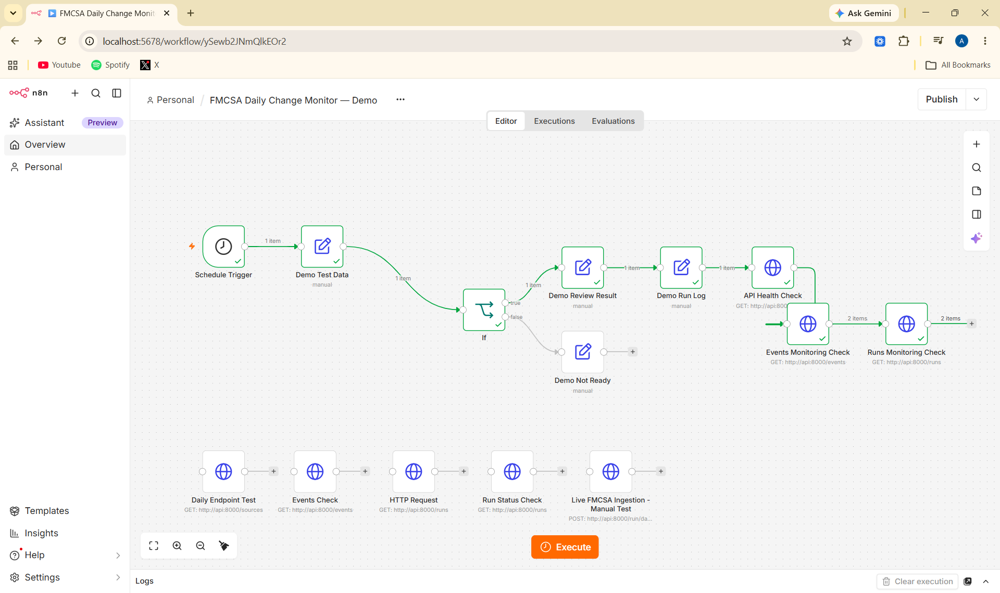

# FMCSA Daily Change Monitor

### Portfolio Case Study | Python · FastAPI · PostgreSQL · Docker · n8n

## Overview

The FMCSA Daily Change Monitor is a portfolio prototype designed to track changes in motor carrier records, match records against a watchlist, maintain event history, and prepare for future alerting workflows.

The project demonstrates API development, database integration, duplicate prevention, automated testing, workflow orchestration, and monitoring concepts.

**Project status:** Local prototype verified with synthetic data. End-to-end live ingestion and scheduled live automation remain unverified.

## The Problem

Carrier insurance and operating-authority changes can require timely review. Manually checking records and maintaining a history of changes can be repetitive and difficult to audit.

This prototype explores how a repeatable monitoring workflow could identify relevant carrier changes, preserve event history, and prepare a foundation for future notifications.

## The Solution

A containerized application built with Python, FastAPI, and PostgreSQL, supported by synthetic test data and an n8n workflow scaffold.

## Features

- **Watchlist matching:** Match carrier records using USDOT and MC identifiers.
- **Change-event tracking:** Store carrier-change events in PostgreSQL.
- **Duplicate prevention:** Avoid creating duplicate events when unchanged records are processed again.
- **Run history:** Record execution status, row counts, created-event counts, and errors.
- **API endpoints:** Expose health, source configuration, event history, and run history.
- **Automated tests:** Validate application behavior.
- **Workflow monitoring:** Demonstrate API health, event, and run-history checks through n8n.
- **Optional CRM integration:** Zoho CRM synchronization and task creation are disabled by default.
- **Human-review concept:** Demonstrate a review step before operational action.

## Architecture

1. Synthetic records enter the processing workflow.
2. The application normalizes records and matches them against the watchlist.
3. Matching changes are evaluated for event creation.
4. PostgreSQL stores event history and run metadata.
5. API endpoints expose monitoring and verification results.
6. Future integrations can support notifications and CRM synchronization.

## Verified Results

The local environment and synthetic demonstration were tested. The latest local automated test run completed successfully.

| Check | Result |
|---|---|
| Local automated test suite | 20 passed |
| Synthetic carrier rows | 2 |
| Watchlist matches in the recorded demo | 2 |
| Existing synthetic demo events retrieved | 2 |
| New events on repeated unchanged demo runs | 0 |
| Recorded demo run status | `completed` |
| Errors in the recorded demo run | 0 |
| Live FMCSA ingestion during the synthetic demo | Not performed |
| Zoho CRM synchronization during the demo | Not performed |

The repeated synthetic demo created no additional duplicate events. The recorded run history showed two matched rows and no errors.

These results describe the synthetic demonstration, not a live FMCSA monitoring run.

## FMCSA Dataset Configuration

The configured dataset identifiers are:

| Source | Dataset ID |
|---|---|
| Motus Carrier | `nakq-58th` |
| Motus Insurance History | `xe5s-wca7` |
| Motus Authority History | `dm5j-zc6c` |
| Motus Insurance | `x96h-evps` |
| Motus Revoke/Suspend | `e67p-xyd5` |

These identifiers have been checked against the official Socrata API. Configuring dataset identifiers and performing read-only source checks do not establish that complete live ingestion or production event processing has been verified.

## Run the Synthetic Demo

From the project root, start the Docker Compose services:

```bash
docker compose up -d --build
```

Run the synthetic demo:

```bash
docker compose exec api python -m scripts.run_demo
```

The demo uses synthetic carrier records from `data/sample/demo_carrier_rows.json` and the test watchlist in `data/sample/demo_watchlist.csv`.

If the demo watchlist has not yet been imported into the Docker database, run:

```bash
docker compose exec -T api python -c "import csv; from app.repository import import_watchlist; rows=list(csv.DictReader(open('/app/data/sample/demo_watchlist.csv', newline='', encoding='utf-8'))); print('Imported companies:', import_watchlist(rows))"
```

Expected behavior for a fresh synthetic dataset is two watchlist matches and two new events. Re-running unchanged demo data should not create duplicate events.

**Important:** The synthetic demo does not call the live FMCSA API or Zoho CRM.

## Run Automated Tests

Run the test suite locally:

```bash
py -3.13 -m pytest -q
```

The latest local test result was **20 passed**.

To run tests inside the Docker API container, use:

```bash
docker compose exec api python -m pytest -q
```

The Docker test result should be verified separately if the container does not contain the latest local code.

## Inspect the API

With the services running, open:

- Health check: http://127.0.0.1:8000/health
- Interactive API documentation: http://127.0.0.1:8000/docs
- Recent events: http://127.0.0.1:8000/events
- Run history: http://127.0.0.1:8000/runs
- Configured sources: http://127.0.0.1:8000/sources

The `docker-demo-run-20261026` entry is a synthetic test record, not a live FMCSA ingestion run.

## n8n Workflow

The workflow is named **FMCSA Daily Change Monitor — Portfolio Demo**.

The verified demonstration path is:

`Schedule Trigger → Demo Test Data → IF → Demo Review Result → Demo Run Log → API Health Check → Events Monitoring Check → Runs Monitoring Check`

The synthetic review path and API monitoring checks have executed successfully.

The schedule is configured for daily execution at 7:00 AM in the Asia/Manila timezone. The workflow remains inactive so the prototype does not run automatically before live ingestion and the required configuration are verified.

The separate `Live FMCSA Ingestion - Manual Test` node is intentionally unconnected and has not been executed.

### n8n Workflow



The screenshot shows the workflow structure used in this FMCSA monitoring portfolio prototype.

## Authentication Check

The API includes an `/auth-check` endpoint for validating the `X-Run-Token` header. The automated tests cover requests with missing, invalid, and valid tokens.

Protected endpoint authentication and the corresponding automated tests do not, by themselves, establish that every operational workflow has been security-reviewed for production use.

## Zoho CRM Integration

Zoho CRM synchronization and task creation are disabled. Delivery of CRM updates and tasks has not been integration-tested.

## Technology Stack

- Python 3.13
- FastAPI
- PostgreSQL
- Docker Compose
- pytest
- n8n
- FMCSA public dataset configuration
- Optional Zoho CRM integration

## Verification Scope and Limitations

Verified checks cover the local application and database setup, synthetic event processing, watchlist matching, duplicate prevention, API endpoints, automated tests, and the n8n demonstration and monitoring path.

The following remain unverified:

- End-to-end live FMCSA ingestion and processing of current source records
- Production watchlist matching using real carrier data
- Scheduled n8n execution against the live ingestion endpoint
- Zoho CRM synchronization and task delivery
- Production-scale performance, alert reliability, and operational recovery

This project is a portfolio prototype. It demonstrates the application structure, synthetic event-processing behavior, monitoring endpoints, authentication checks, and human-review workflow. It is not presented as a production-ready monitoring service.

## Next Steps

1. Validate ingestion against official FMCSA daily-difference datasets.
2. Test scheduled execution and error handling through n8n.
3. Add operational monitoring and notification delivery.
4. Validate optional CRM integration in a controlled test environment.
5. Document deployment and recovery procedures.

## Repository

[FMCSA Daily Change Monitor on GitHub](https://github.com/mascachu/fmcsa-carrier-monitor)
